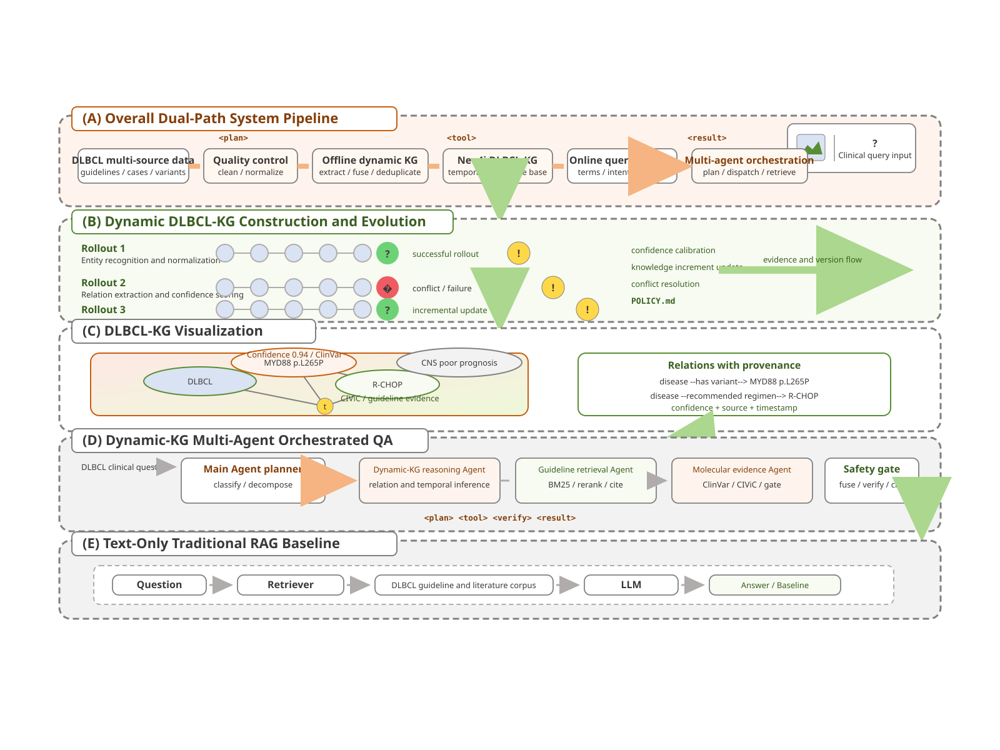

# Guideflow 双 Agent 设计报告：问答 Agent 与分子证据 Agent

> 适用代码版本：2026-09。覆盖路径 `backend/app/services/agent_orchestrator.py`（问答 Agent）、
> `backend/app/services/molecular_agent_llm.py` + `backend/app/services/molecular_evidence.py`（分子证据 Agent）、
> `backend/app/services/agent_tools.py`（工具契约）、`backend/app/prompts.py`（提示词）、
> `backend/app/services/qa.py`（问答编排）、`backend/api/routes_molecular_evidence.py`（分子证据 API）。
> 另有《分子证据 Agent 工具循环与护栏实现说明》用于对照实现细节。

---

## 1. 总览：一句话讲清两个 Agent 分工

### 1.1 可视化架构图

下图展示了用户请求如何进入问答 Agent、如何通过 `molecular_evidence_lookup` 嵌套进入分子证据 Agent，以及最终如何经过安全门控和答案组装。



- 蓝色：问答 Agent（`AgentOrchestrator`）
- 橙色：分子证据 Agent（`MolecularLLMAgent`）
- 绿色：确定性规则层（建卡、安全门控、答案组装、缓存和审计）
- 虚线橙框：问答 Agent 通过工具调用进入的子 Agent

- **问答 Agent（指南导向，检索规划型）**：负责“为用户问题规划跨源检索路线”，输出的是
  `AgentState`（命中证据 `hits`、候选图页 `candidate_pages`、图谱三元组 `graph_hits`、渲染图 `figures`、
  路径 `route ∈ {flowchart, evidence, hybrid}`、分子证据摘要 `molecular_evidence`），不直接写最终长文答案。
- **分子证据 Agent（变异证据型，自主检索型）**：负责“把一个或多个基因变异（如 `MYD88 p.L265P`）
  变成带来源、分级、门控的证据卡”，输出的是 `MolecularEvidenceResult`（变异、证据卡、安全门控、
  医生摘要、缺失信息、审计 trace）。
- **一句话关系**：问答 Agent 需要时把“分子证据 Agent”当成一个工具调用
  （`molecular_evidence_lookup`），两个 Agent 是“主从嵌套”而非并列。

```
用户问题
  │
  ├─ 无变异（常规指南问答）────────────────────────────┐
  │                                                    ▼
  │                                     问答 Agent 循环（AgentOrchestrator）
  │                                       search_guidelines → query_graph → view_pages
  │                                       → respond_directly（闲聊/通用医学直答）
  │
  └─ 含基因变异（MYD88 p.L265P / TP53 p.R248Q …）──────┼──▶ molecular_evidence_lookup
                                                      │       │
                                                      │       ▼
                                                      │    分子证据 Agent 循环（MolecularLLMAgent）
                                                      │       resolve → search_clinvar/civic/myvariant → finish
                                                      │       → 补查 → 建卡 → 安全门控 → 组装报告
                                                      │
                                                      ▼
                                              答案生成器（Qwen/VLM）+ 审计落库
```

**核心设计原则（两 Agent 共用）**：

1. **LLM 只管“怎么查”，不管“怎么断”**：检索策略由大模型自由规划；是否能说、
   能说到什么强度（`allow / downgrade / ask_for_confirmation / refuse`）全部由确定性规则裁定。
2. **工具返回的是“证据摘要”，不是结论**：每个工具给模型一段可引用的文本摘要，
   模型再决定下一步，证据链可追溯。
3. **失败必有确定性兜底**：无 Key、超时、供给异常 → 线性/确定性回退，保证“有答案、可审计”。

---

## 2. 问答 Agent：指南检索规划智能体

### 2.1 定位与输入输出

- **文件**：`backend/app/services/agent_orchestrator.py`（`AgentOrchestrator`）。
- **调用方**：`QAService.ask / ask_stream`（`backend/app/services/qa.py`）先做意图分类与问题改写，
  再把 `standalone_question`、历史、`disease_scope`、trace 交给 Agent。
- **输入**：用户原问题、改写后的独立问题、对话历史、疾病范围（`DiseaseScope`）、trace 记录器。
- **输出**：`AgentState`（`backend/app/services/agent_tools.py`），字段含义：
  `hits`（检索命中）、`graph_hits`（图谱三元组）、`figures`（渲染图）、`candidate_pages`
  （可被 `view_pages` 点名的候选页）、`route`（问答路径）、`answer_kind`（指南/闲聊/通用医学）、
  `early_answer`（直接回答时预生成正文）、`molecular_evidence`（分子证据摘要）、`ready`（是否可进入生成）。

### 2.2 工具箱（5 工具）与适用场景

工具契约集中在 `TOOL_DEFINITIONS`（`agent_tools.py`），执行分发在 `AgentOrchestrator._dispatch`：

| 工具 | 参数 | 做了什么 | 何时用 |
|---|---|---|---|
| `search_guidelines(query, kind)` | `kind ∈ {flowchart, evidence, any}` | BM25+重排混合检索 → 疾病守卫 → 可选 LLM 证据门控 → 种子页注入 → 生成候选页清单 | 诊疗/分期/方案/任意指南问题**必先调用** |
| `view_pages(page_codes[])` | 来自候选清单的页码 | 渲染 PDF 页图、回填证据序号、拼 `FigureReference` | 决策图/方案表有助于回答时；路径类要求同时带决策页与方案表 |
| `query_graph(question, relation?)` | 关系可选 | `KnowledgeGraphRetriever` 取三元组 `[G1] A --REL--> B` | 文本证据不足且需关系推理时 |
| `molecular_evidence_lookup(variants_text, disease?, question?, provider_mode?)` | 见 §3.5 | 内部起一个 `MolecularEvidenceService(provider_mode="mock")`，返回精简摘要 | 问题含 `基因+HGVS`（如 `MYD88 p.L265P`）时；默认 mock 不走外网 |
| `respond_directly(kind)` | `chitchat / general_medical` | 直接生成闲聊或通用医学说明，`route="none"` | 问候/闲聊/指南外常识；走完直接结束 |

**能力开关**：`_active_tools()` 按 Settings 动态裁剪。CSCO/EHA 源关闭 VLM/流程图/图谱时，
`view_pages` 与 `query_graph` 自动不可用，提示词也有 CSCO/EHA 专用版本约束“不要调不存在的工具”。

### 2.3 决策循环（Planner-Executor，两套同构实现）

`run()`（同步）与 `run_streaming()`（SSE 流式）是同一循环的两种外壳：

```
messages = qwen.build_agent_messages(standalone, history)   # 系统提示=AGENT_SYSTEM_PROMPT
for step in 0 .. agent_max_steps(默认4):
    assistant_msg, tool_calls, degraded = qwen.run_tool_turn(messages, tools=_active_tools())
    if degraded: 记录 → _linear_fallback → 结束
    messages.append(assistant_msg)
    if content 含 {"ready": true} 且无 tool_calls:
        route = ready.route ∈ {flowchart,evidence,hybrid}; 结束
    if 无 tool_calls（模型停了）: 视为 ready（若已有 hits）; 结束
    for call in tool_calls:
        emit(status_for_tool(...))              # 前端实时状态
        result_text = _dispatch(call)           # 执行工具并写 AgentState
        state.steps.append(...); trace.log(agent_tool_call, ...)
        messages.append({role:"tool", tool_call_id, name, content: result_text})
        if state.early_answer: 结束（闲聊/通用医学已生成）
收尾：
  hits 为空且无 early_answer → 强制补一次 search_guidelines(kind=any)
  _should_upgrade_to_flowchart() → evidence→flowchart 软升级（仅当种子页/首命中真是决策图页）
  state.ready = True
```

**关键护栏**：

- 无 Key（`qwen.api_key` 为空）直接 `_linear_fallback`：固定查一次指南 + 确定性配图，不走 LLM。
- 工具异常（`degraded` 字符串）同样回退线性，保证“永不空手而归”。
- `evidence_gating`（`qwen.gate_evidence`）对命中做“与问题直接相关”过滤，但决策页受保护、
  意图种子页强制回注、疾病命中回注，防止漏掉关键路径页。
- 图预算 `figure_ceiling`（默认 4）：`view_pages` 只能选候选清单内的页，超限截断。

### 2.4 提示词设计（`backend/app/prompts.py`）

- `AGENT_SYSTEM_PROMPT`（NCCN）：要求“只做检索规划、不写临床长文”，规则 1–3 定检索顺序，
  规则 4 规定变异问题要调分子工具（mock），规则 5 要求合并同类调用、避免重复检索，
  规则 7 要求证据足够立即 `{"ready":true,"route":...}`，规则 8 禁止编造页码。
- `CSCO_AGENT_SYSTEM_PROMPT / EHA_AGENT_SYSTEM_PROMPT`：能力受限版（只能 evidence 路线），
  显式禁止 `view_pages / query_graph` 与编造 NCCN 页码。
- 最终答案另有 `SYSTEM_PROMPT / MULTIMODAL_SYSTEM_PROMPT / CSCO/EHA_SYSTEM_PROMPT` 约束
  “每个医学判断带 `[Sn]`、未提及实体必须明示、禁止超证据推测”，与规划提示词职责分离。

### 2.5 问答 Agent 的两种“直答”短路

`respond_directly(kind=chitchat)` → `qwen.generate_chitchat`；`kind=general_medical` →
`qwen.generate_general_medical`（强制首行“非指南内容”横幅、结尾就医提示）。
这一步直接写 `state.early_answer`，问答循环提前结束，不再检索。

---

## 3. 分子证据 Agent：变异证据自主检索智能体

### 3.1 定位与输入输出

- **文件**：`backend/app/services/molecular_agent_llm.py`（`MolecularLLMAgent`，真 LLM Agent）；
  `backend/app/services/molecular_evidence.py`（`MolecularEvidenceAgent` 确定性版 + 解析/建卡/门控/组装全链路）。
- **调用方**：① 分子证据专页 `POST /api/molecular-evidence/query[/stream]`；
  ② 问答 Agent 的 `molecular_evidence_lookup` 工具（内部 `service.analyze(...)`）。
- **输入**：变异文本（如 `MYD88 p.L265P, CD79B p.Y196H`）、疾病（默认 DLBCL）、样本类型、
  参考基因组/转录本提示、用户追问。`MolecularInputParser` 先做标准化。
- **输出**：`MolecularEvidenceResult.to_dict()`，结构见 §5.1。
- **模式开关**：`agent_mode ∈ {deterministic, llm, auto}`（请求参数/环境变量），
  `provider_mode ∈ {mock, live, hybrid}` 管数据源。`mock` 强制 deterministic，保证离线稳定；
  `auto` 有 Key 上 LLM、无 Key 透明降级；`live` 显式要求 LLM 时无 Key 也建 LLM Agent 以便打出降级 trace。

### 3.2 工具箱（5 工具）与分工

契约在 `MOLECULAR_TOOL_DEFINITIONS`（`molecular_agent_llm.py`），执行在 `_dispatch`：

| 工具 | 语义 | 执行器 |
|---|---|---|
| `resolve_variant_coordinates(variant_id)` | 补转录本/cDNA/基因组坐标/GRCh 版本 | `MyVariantResolver`（live）/ `MockVariantResolver`（mock）/ `CompositeVariantResolver`（hybrid）；写回变异并重跑 `MappingValidator` |
| `search_clinvar(variant_id)` | 胚系致病性/体细胞致癌性线索（必查） | `_ProviderView(ClinVarProvider)` |
| `search_civic(variant_id)` | 临床证据等级与疾病匹配（必查） | `_ProviderView(CivicProvider)` |
| `search_myvariant(variant_id)` | 群体频率/功能预测/rsID（可选） | `MyVariantProvider` 或 mock 视图 |
| `finish_evidence_collection(reason)` | 声明覆盖完成，结束检索 | 仅写 trace，不产生记录 |

提示词 `MOLECULAR_AGENT_SYSTEM_PROMPT` 给了硬约束 + 效率规则 + few-shot 示例轨迹：
每个可检索变异必查 `ClinVar+CIViC`；`protein_level_only` 必须先 resolve 再 search；
无基因的 `insufficient/ambiguous/conflicting` 禁止 search；禁止编造 `variant_id`；
禁止直接输出临床结论；同对去重、必查覆盖后尽快 finish。

### 3.3 决策循环（自主检索 + 确定性收敛）

`run_streaming()` 是生成器：`yield status/tool_result` 供 SSE 实时推送，`return` 携带
`(records, trace, provider_status, resolver_status)`；`run()` 只是把它跑完取返回值（兼容旧调用）。

```
trace.append(plan{agent:"llm", policy:"llm_decides_tool_order_then_finish", max_steps})
yield planning
variants 为空 → finalize → 返回
无 Key → _linear_fallback(确定性 Agent 全量跑一遍，trace 打 llm_fallback_to_deterministic) → 返回

初始化 provider_status（ClinVar/CIViC 必查，其余可选）、resolver_status、
records / seen_records / queried_pairs{(variant,库)} / dedup_cache / total_tool_calls

for step in 0 .. max_steps(默认8):
    预算守卫：total_tool_calls > max_steps*6 → budget 状态 → 收敛
    早停提示：step>0 且必查全覆盖 → 向 messages 注入 system 提示“请直接 finish”
    assistant_msg, tool_calls, degraded = qwen.run_tool_turn(messages, tools=5工具)
    degraded → yield degraded → 补查缺口 → finalize(degraded) → 返回
    messages.append(assistant_msg)
    content 含 {"ready":true}/finish → agent_ready → 结束
    无 tool_calls → agent_stop_without_tool → 结束
    finish 工具在列 → agent_finish_tool → 结束

    同轮 search 去重：(variant,工具) 已查过 → 直接回 dedup_cache + tool_result(dedup:true)
    resolve 按 protein_level_only 优先、串行执行（会改写变异坐标）
    search 按“必查库→unique 变异→不可检索最后”排序，ThreadPoolExecutor(默认4)并行；
        每完成一个：去重记录、写 trace、yield tool_result、回填 tool 消息
    未知工具 → unknown_tool 错误回灌

收尾（仅当仍有缺口）：
    yield supplement → _supplement_missing_required（见 §3.4）
    _finalize_status → yield complete{record_count, dedup_skipped} → 返回
```

**智能调度四件套**：① 同轮去重 `dedup_cache`（`trace: dedup_skip`）；② 无效变异短路
`_should_skip_search`（无基因+位点不唯一 → `{skipped:true}`，不计入缺口）；
③ 分组并行（`MOLECULAR_SEARCH_PARALLELISM`，2–6）+ 超时（`MOLECULAR_TOOL_TIMEOUT_S`，默认 12s）；
④ 瞬时错误（timeout/502/503/429/连接失败）退避 0.6s 重试一次。

### 3.4 确定性收敛：补查与状态机

- `_supplement_missing_required()`：LLM 漏掉的 `(variant, ClinVar/CIViC)` 对强制补查，
  成功记 `record_count`，失败记 `supplement_error`；这是“医学完备性”的最后一道门，
  与模型是否听话无关。
- `_finalize_status()`：`resolver ∈ {resolved, unresolved, pending, disabled}`；
  `provider ∈ {success, no_evidence, degraded, incomplete, pending}`。
  `error_count>0 → degraded`，保证“未命中 ≠ 无证据”在 UI 与警告中可区分。
- 异常路径同样先补查再 finalize，保证 trace 完整。

### 3.5 问答 Agent 如何“调用”分子 Agent

`AgentOrchestrator._tool_molecular_evidence()`（`agent_orchestrator.py`）：

1. 取 `variants_text / disease / question`，`provider_mode` 缺省 **`mock`**（主问答联动不走外网、防阻塞）。
2. `MolecularEvidenceService(provider_mode="mock").analyze(...)` 全量跑一遍（含解析→检索→建卡→门控→组装）。
3. 只把精简版写进 `state.molecular_evidence`（变异≤4、证据≤6、缺失、全局警告≤4、答案片段≤600字），
   并 `trace.log("molecular_evidence", ...)`。
4. 返回给问答 LLM 的是一段“可引用摘要”（变异行 + 处置优先级 + 边界 + 证据摘要≤500字），
   主答案生成器据此组织语言，不直接粘贴分子报告全文。

---

## 4. 两 Agent 的关键差异对照

| 维度 | 问答 Agent | 分子证据 Agent |
|---|---|---|
| 问题域 | 开放式指南问答（诊疗/分期/方案/机制） | 封闭式变异证据（基因+HGVS → 数据库证据） |
| 大脑 | Qwen，`AGENT_SYSTEM_PROMPT`（分 NCCN/CSCO/EHA 三版） | Qwen，`MOLECULAR_AGENT_SYSTEM_PROMPT`（硬约束+效率+few-shot） |
| 循环步数 | `agent_max_steps` 默认 4（`config.yaml`） | `max_steps` 默认 8（`MOLECULAR_AGENT_MAX_STEPS`） |
| 一轮工具数 | 串行逐个执行 | resolve 串行、search 分组并行（默认 4） |
| 必查语义 | 无（模型可自由决定查什么） | 强必查：每可检索变异 × `ClinVar+CIViC`，漏查强制补 |
| 无效输入 | 闲聊/常识可 `respond_directly` 短路 | 无基因+位点不唯一直接 `skipped`，并提示补 HGVS |
| 去重 | 无（靠提示词“不要重复检索”） | `dedup_cache` + `seen_records` 双层去重，可审计 `dedup_skipped` |
| 早停 | 模型自发 `{"ready":true}` | 模型自发 finish + 系统在必查覆盖后主动注入 finish 提示 |
| 降级 | 无 Key/异常 → `_linear_fallback`（查一次指南+确定性配图） | 无 Key/异常 → `_linear_fallback`（确定性 Agent 全量） |
| 输出 | `AgentState`（证据+图+路线，供答案生成器消费） | `MolecularEvidenceResult`（变异+证据卡+门控+医生摘要，直接可渲染） |
| 审计 | `TraceLogger`（文件）+ `state.steps` | `agent_trace`（随 payload 返回）+ DB 审计日志（见 §5.2） |

---

## 5. 数据与接口：从变异文本到可渲染报告

### 5.1 `MolecularEvidenceResult.to_dict()`（API 与前端的唯一契约）

```
meta:    {provider_mode, agent_mode(实际), agent_mode_requested(期望),
          retrieved_at, cache_hit, cache_key, cache_entry_id, query_log_id,
          required_providers, extended_providers}
query:   {question, disease, sample_type, genome_build, transcript, variant_type,
          provider_mode, agent_mode...}
variants:[{variant_id, gene, protein/cdna/genomic_hgvs, transcript, genome_build,
          mapping_status, warnings, enrichment, molecular_annotation,
          evidence_summary, gate, missing{blocking,advisory}}]
evidence:[{...EvidenceCard, gate:{decision, allowed_claim_strength,
          required_warnings, reasons, blocked_outputs}}]
safety:  {variant_gates:[...], card_gates:[...]}
answer:  {markdown}            # AnswerComposer 组装的全文
summary: {title, conclusion, evidence_strength, variant/card 计数,
          direct/near/proxy 证据计数, provider_counts, primary_variant/gate,
          recommended_next_step, priority_action, highlights, top_evidence}
missing: {blocking:[], advisory:[]}
global_warnings:[...]         # 4 条基础边界 + 降级/无证据追加
audit:   {raw_records, agent_trace, provider_status, resolver_status}
```

`meta.agent_mode`（实际）与 `meta.agent_mode_requested`（期望）分开记录，
`auto→llm`、`llm→deterministic fallback` 在审计中可区分。

### 5.2 缓存、审计与可观测

- **缓存分区**：cache key 含 `{provider_mode}:{agent_mode}:providers-v10-agent-zh`，
  llm 与 deterministic 结果不串扰；TTL 7 天（`CACHE_TTL_DAYS`）。
- **审计落库**：`molecular_evidence_query_logs`（输入/标准化/原始记录/证据卡/门控/答案全文/
  是否命中缓存）与 `molecular_evidence_cache_entries`（payload 全量）。
- **流式事件**（`analyze_stream` → `POST /query/stream` → SSE）：
  `{type:status, stage, label, detail}` / `{type:tool_result, tool, arguments, result, stage, dedup?}` /
  `{type:final, payload}` / `{type:error, detail}`。前端轨迹面板逐条渲染，失败自动回退 `POST /query`。

---

## 6. 安全设计：为什么“模型说了不算”

两 Agent 共享同一套“检索自由、结论受限”的安全观，只是落点不同：

- **问答侧**：答案生成提示词强制“每个医学判断带 `[Sn]`、未提及实体必须明示、
  禁止超证据推测”（`SYSTEM_PROMPT` 系列）；证据门控 + 疾病守卫 + 种子回注保证关键页不丢；
  通用医学直答强制“非指南内容”横幅。
- **分子侧**：`SafetyGate` 分变异级（映射状态/缺失信息）与卡级（证据等级/疾病匹配/
  记录状态/冲突）两层裁决 `allow / downgrade / ask_for_confirmation / refuse`；
  `AnswerComposer` 按门控桶生成结论强度与下一步建议；`global_warnings` 恒带 4 条边界
  （不构成诊疗建议、不由致癌性推靶向、不跨癌种外推、不做个体预后）。
- **共同点**：`degraded / no_evidence / incomplete` 三态分离——“查失败了”“查到了但无证据”
  “没查全”是三种不同的警告文案，前端与报告中均可区分。

---

## 7. 配置与运行模式速查

| 开关 | 位置 | 含义 |
|---|---|---|
| `routing_mode: agentic/linear` | `config.yaml` | 问答走 Agent 循环还是旧线性流程（回退） |
| `agent_max_steps` | `config.yaml` | 问答 Agent 最大轮数（默认 4） |
| `enable_molecular_evidence` | Settings + 三源默认开 | 问答 Agent 是否可见 `molecular_evidence_lookup` |
| `MOLECULAR_EVIDENCE_PROVIDER_MODE=mock/live/hybrid` | 环境变量 | 分子数据源；`mock` 强制 deterministic |
| `MOLECULAR_AGENT_MODE=auto/llm/deterministic` | 环境变量/请求 `agent_mode` | 分子大脑选择；`auto` 有 Key 上 LLM |
| `MOLECULAR_AGENT_MAX_STEPS` | 环境变量（默认 8） | 分子 Agent 最大轮数 |
| `MOLECULAR_SEARCH_PARALLELISM`（2–6，默认 4）/ `MOLECULAR_TOOL_TIMEOUT_S`（默认 12） | 环境变量 | 分子 search 并发与超时 |

典型验证：

```bash
# 分子专页流式（看 SSE 轨迹）
curl -N -X POST http://127.0.0.1:8001/api/molecular-evidence/query/stream \
  -H "Content-Type: application/json" \
  -d '{"variants_text":"MYD88 p.L265P","disease":"DLBCL","sample_type":"tumor tissue","provider_mode":"live"}'

# 主问答联动（自动触发 molecular_evidence_lookup）
curl -X POST http://127.0.0.1:8001/api/ask -H "Content-Type: application/json" \
  -d '{"question":"MYD88 L265P 在 DLBCL 中如何解释？","data_source":"nccn"}'
```

---

## 8. 小结

- 问答 Agent 是“**路线规划者**”：在指南页、讨论段落、知识图谱、流程图、分子证据之间做取舍，
  产出结构化检索状态供答案生成器消费。
- 分子证据 Agent 是“**证据检索执行者**”：在坐标补全与三库之间自主调度，用必查+补查+去重+门控
  把“变异字符串”变成“可引用、可分级、可审计的证据卡”。
- 两者通过 `molecular_evidence_lookup` 嵌套：主 Agent 负责“要不要查分子”，子 Agent 负责“怎么查全”，
  规则层负责“能不能说”。这就是本项目“真 Agent + 强护栏”的完整思路。

---

## 9. 体细胞致癌性积分与扩展证据库（2026-09 补齐）

对照“多库取证 + 加减分 + 五档 + 高分触发文献”思路，补齐情况：

- 积分器：`backend/app/services/oncogenicity.py`（`SomaticOncogenicityScorer`），12 项标准，
  O≥10 / LO 6–9 / VUS 0–5 / LB -6–-1 / B≤-7；证据不足默认 VUS；≥6 分触发 PubMed。
- 新库：UniProt（蛋白功能/结构域，免费）、OncoKB（致癌性/hotspot/治疗，无 token 自动跳过）、
  PubMed（E-utilities，≥6 分门控触发，摘要级降级）。
- 结果：每变异附 `oncogenicity`（score/tier/明细），报告模板与前端变异卡展示分档；
  缓存版本 v12。
- 未做：COSMIC（license 门槛）、70 例专家验证集（用固定金标准单测代替，
  见 `tests/test_oncogenicity_scorer.py`）。
